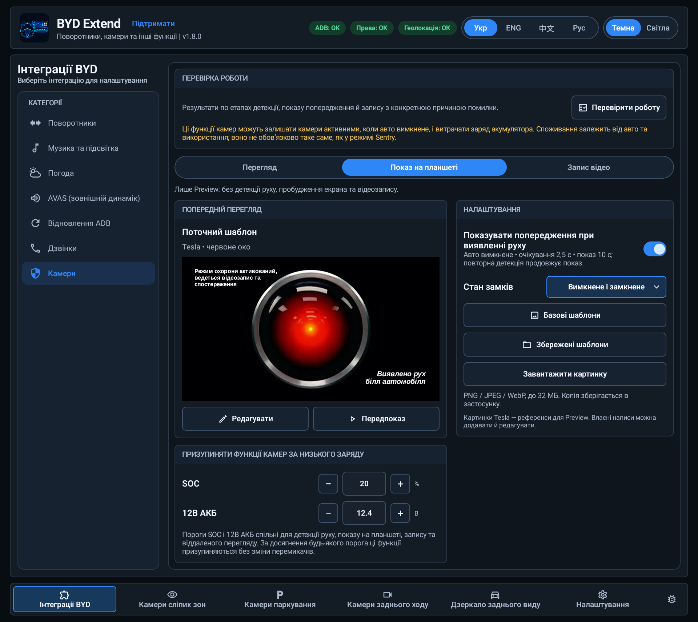
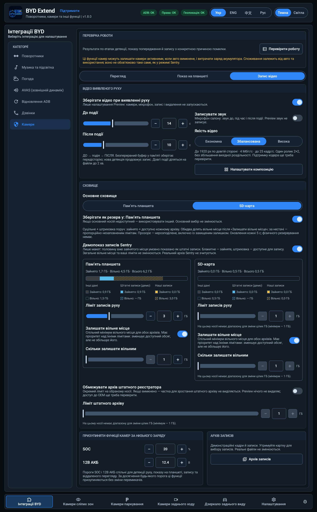
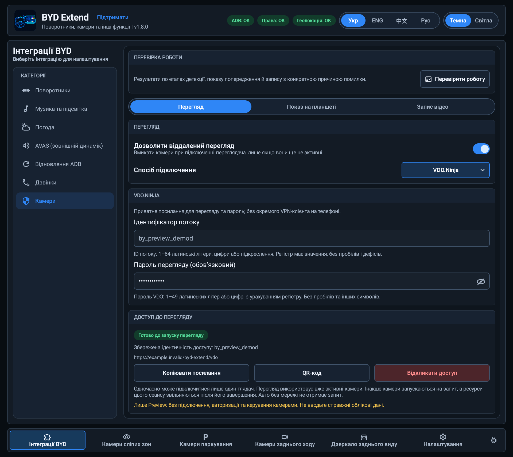
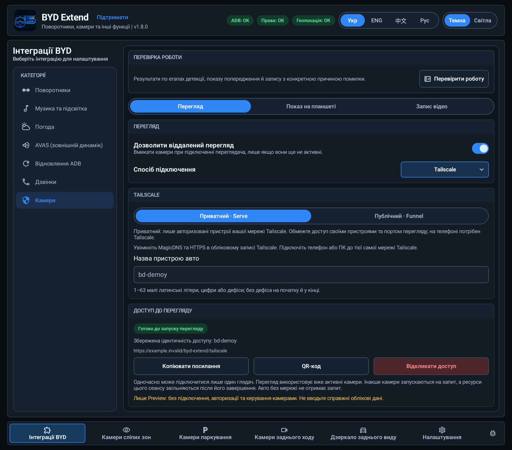
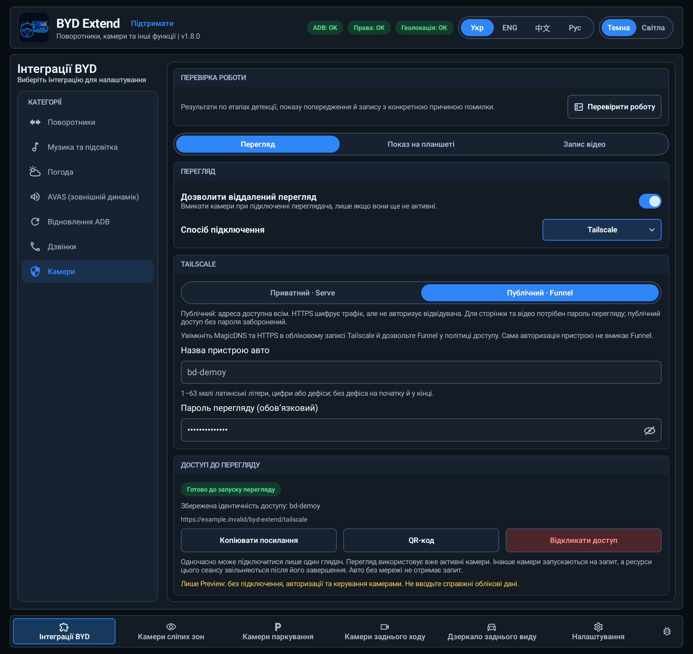
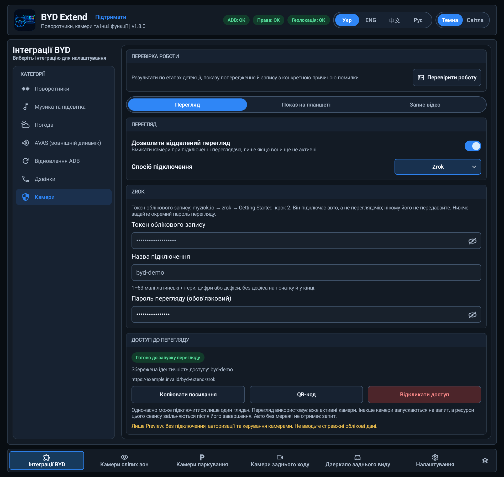

# BYD Extend

[English](README.md) | **Українська**


BYD Extend додає налаштовувані види камер, віджет дзеркала заднього виду, допоміжні функції поворотників та необов'язкові інтеграції музики, погоди й зовнішнього звуку для сумісних автомобілів BYD.

**Це незалежний допоміжний застосунок, а не заміна систем безпеки автомобіля. На відміну від переглядача телеметрії, його увімкнені функції поворотників можуть змінювати їхній стан. Налаштовуйте та перевіряйте застосунок лише на припаркованому авто.**

- **Сумісність:** насамперед перевірено на BYD Sea Lion 07 EV 2025 китайського ринку з DiLink 5.0. Робота функцій на інших моделях і прошивках, зокрема виведення на приборку, не гарантована.
- **Завантаження:** [останній реліз на GitHub](https://github.com/sunlixWhyNotAvailable/byd-turnsignal-cameraview/releases/latest).
- **Пакет:** `com.byd.extend` — окремий застосунок від попереднього BYD Turn Signal.
- **Допомога:** [Залежність від ADB](#які-функції-потребують-adb) · [Віддалені камери](#віддалений-перегляд-камер-налаштування-та-використання) · [Усунення проблем](#усунення-проблем) · [Повідомити про проблему](#повідомити-про-проблему).

## Встановлення та перший запуск

Потрібні Android 8.0 або новіший, сумісна система DiLink і можливість встановлювати APK. Локальний ADB потрібен для перелічених нижче функцій, а не для кожного екрана чи можливості. Через нього застосунок запускає привілейовані процеси-хелпери та виконує системні операції.

1. Завантажте APK **BYD Extend** зі сторінки релізу. Якщо там декілька застосунків, оберіть `byd-extend-v<version>.apk`. Звірте контрольну суму SHA-256 з опублікованою, якщо вона є.
2. Встановіть і відкрийте застосунок, коли автомобіль припаркований.
3. Виконайте підказку щодо фонової роботи: у налаштуваннях DiLink встановіть `Disable background Apps -> BYD Extend` у `OFF`.
4. Для функцій, що потребують ADB, увімкніть локальний ADB способом, доступним у вашій прошивці, та підтвердьте запит Android на авторизацію BYD Extend. Натисніть `Видати ADB` у налаштуваннях застосунку для надання потрібного доступу.
5. Надайте запитані дозволи: камери — для зображення, показ поверх інших застосунків — для віджетів, локація — для погоди, мікрофон — для мовлення назовні. Дії з керма й деякі інтеграції також потребують служби спеціальних можливостей (Accessibility); перевіряйте стан дозволів у налаштуваннях.
6. Увімкніть `Авто-запуск`, якщо потрібні автоматичний запуск і відновлення. Налаштуйте лише потрібні функції.
7. Перевірте джерело, орієнтацію, розташування та калібрування кожної камери перед її використанням.

**Відновлення ADB — не первинне розблокування.** Потрібні вже авторизований ключ і відповідний системний дозвіл. Цей механізм не може авторизувати нове встановлення, коли весь доступ ADB закритий. Після оновлення прошивки або скидання планшета налаштування доступу може знадобитися повторити.

### Які функції потребують ADB?

У таблиці **«Так»** означає, що авторизований локальний ADB потрібен для запуску/перезапуску привілейованого хелпера або виконання зазначеної операції. Уже запущений хелпер може спілкуватися із застосунком без постійного ADB-з'єднання, але його повторний запуск після перезавантаження, збою чи заміни потребує ADB. Тримати ноутбук підключеним **не потрібно**.

| Функція | Чи потрібен авторизований ADB? |
| --- | --- |
| Захист поворотника та ручне керування поворотниками | **Так**, для запуску/перезапуску хелпера керування. |
| Виведення камер сліпих зон, паркування, заднього ходу та дзеркала | **Так**, для запуску/перезапуску хелперів камер і стану авто, зокрема для звичайного попереднього перегляду камер у застосунку. Це стосується планшета й приборки. |
| Камери: попередження на планшеті, запис Motion та віддалений перегляд | **Так**, для запуску/відновлення відповідних хелперів. Віддаленому перегляду також потрібен інтернет на авто; переглядачу на телефоні/ПК ADB не потрібен. Відтворення вже збережених локальних відео не потребує живого джерела камер. |
| Метадані музики, візуалізація/підсвітка та спрямування команд керма до плеєра | **Так**, для запуску/перезапуску музичного хелпера. Керування плеєром також потребує Accessibility. |
| Звуки подій AVAS, прослуховування файлів, мовлення через мікрофон назовні та імітація двигуна | **Так**, для запуску/перезапуску аудіохелпера. Мовлення також потребує дозволу мікрофона й підключеної служби Accessibility застосунку. |
| Отримання погоди й оновлення штатної картки | **Ні** для звичайного оновлення на сумісній прошивці. Потрібні дозвіл локації, інтернет і доступ до штатного постачальника даних погоди. Перехоплення штатної кнопки оновлення погоди також потребує Accessibility. |
| Навчання кнопок і розпізнавання одного/подвійного натиску та утримання | **Ні**, якщо Accessibility вже увімкнено й підключено. Виконання призначеної дії камер, музики чи звуку зберігає вимоги з рядків вище. |
| Мова/тема, редагування збережених налаштувань та імпорт/експорт JSON-пресетів камер | **Ні** для локальних налаштувань і файлів. Застосування до живої камери чи функції авто все одно потребує її робочого хелпера. |
| Перевірка/завантаження оновлень та вікно підтримки | **Ні**. За потреби використовуються інтернет і дозвіл Android на встановлення APK; віджети-підказки потребують дозволу накладання. |
| Автоматична видача дозволів, зокрема WRITE_SECURE_SETTINGS та Accessibility | **Так**. Уже виданий дозвіл не означає, що ADB-з'єднання зараз доступне. |
| Імпорт налаштувань із BYD Turn Signal | **Так**, для читання даних старого застосунку та завершення передачі керування. Це не те саме, що завантаження JSON-пресету камер. |
| Надсилання/збереження власних локальних діагностичних файлів застосунку | **Ні** для цих файлів. Експорт усе одно намагається зібрати системні дані; без ADB недоступні розділи позначаються, а архів буде неповним. |
| Зріз повного системного logcat, експорт історії безперервного logcat та збір пакета сумісності | **Так**, для читання системних даних через shell. Запуск/перезапуск безперервного записувача також потребує ADB. |

**Відновлення ADB — окремий випадок:** воно має працювати саме тоді, коли звичайний ADB недоступний, але потребує раніше авторизованого ключа й раніше виданого WRITE_SECURE_SETTINGS. Шлях через Wi-Fi також потребує Wi-Fi та необхідних системних підтверджень. Первинного налаштування це не замінює.

Авторизація ADB не замінює дозволів камери, мікрофона, локації, накладання чи Accessibility. І навпаки: надання цих дозволів Android не звільняє функції з хелперами від потреби в ADB.

### Перехід із BYD Turn Signal

BYD Extend встановлюється окремо й не замінює BYD Turn Signal. Під час першого запуску пропонується імпорт налаштувань; ця сама дія доступна пізніше в налаштуваннях.

Залиште старий застосунок встановленим до успішного імпорту. Потрібні авторизований ADB і доступ до даних старого застосунку. Переносяться налаштування та калібрування, але не дозволи Android чи авторизація ADB. Після успішного перенесення робота старого застосунку зупиняється без видалення самого застосунку та його даних. Не запускайте обидва застосунки одночасно як конкуруючі контролери камер або поворотників.

## Щоденне використання

Інтерфейс доступний англійською, українською, спрощеною китайською та російською мовами, у темній і світлій темах. Нове встановлення починає роботу англійською; вибір мови не залежить від мови планшета.

### Поворотники

У `Інтеграції BYD -> Поворотники` налаштуйте захист поворотника: кут повороту, повернення до центру, затримку та швидкість. Також доступні ручне керування лівим і правим поворотниками, аварійкою та скидання.

Функція залежить від коректної телеметрії та сумісного керування BYD. Це не асистент зміни смуги; завжди перевіряйте фактичний стан поворотників і ситуацію навколо.

Ключові скриншоти показано одразу; деталізація доступна в розгортаних блоках. Усі зображення українською зроблено з Preview у темній темі з демонстраційними даними; сторінки з прокручуванням склеєно.

<p align="center"></p>

### Камери сліпих зон

Налаштовуйте задню та передню групи незалежно: увімкніть потрібні види, оберіть умови їхньої появи та розташування на планшеті або приборці.

- Серед доступних умов — поворотники, швидкість, кут керма й виявлення об'єкта у сліпій зоні, якщо авто надає ці сигнали.
- `Утримувати камеру` залишає відповідний вид ще на **1–5 секунд** після короткого поворотника; початкова тривалість — три секунди.
- `Не показувати під час панорамного виду` стосується **тільки планшета**, а не приборки.
- Для кожного виду налаштовуються обрізання, сила корекції, поворот, віддзеркалення, розміри та рамка.

<p align="center"></p>

<details>
<summary>Розташування та калібрування</summary>

#### Розташування

<p align="center"></p>

#### Калібрування: оригінал

<p align="center"></p>

#### Калібрування: корекція

<p align="center"></p>

#### Калібрування: вивід

<p align="center"></p>

</details>

### Камери паркування

Оберіть потрібні види та налаштуйте пороги відстані й швидкості. Автоматична активація потребує сумісних даних датчиків наближення та швидкості; підтримка може відрізнятися між автомобілями.

Кожна камера має власні налаштування зображення. Ці види доповнюють штатні камери й парктроніки, а не замінюють їх.

<p align="center"></p>

<details>
<summary>Розташування та калібрування</summary>

#### Розташування

<p align="center"></p>

#### Калібрування: оригінал

<p align="center"></p>

#### Калібрування: корекція

<p align="center"></p>

#### Калібрування: вивід

<p align="center"></p>

</details>

### Камери заднього ходу

Увімкніть `Покращений задній вид`, оберіть елементи композиції та розмістіть їх у попередньому перегляді. Елементи мають окремі положення й розміри для планшета та приборки; увімкнена інтеграція передньої камери додає відповідний передній профіль.

- Увімкнення R запитує задні види без очікування вікна штатної панорами.
- Необов'язковий перемикач `Перемикати за передачею` обирає інтегровані передні види в D та задні в R. N і P зберігають поточний вибір у межах сесії.
- Перемикання за передачею доступне лише за наявності хоча б однієї увімкненої передньої інтеграції. Камери без інтеграції залишають задній вид.
- Віджет вибору та навчена кнопка керма дозволяють вручну перемикати активну композицію. Кнопка реагує на один короткий натиск і не відкриває неактивну композицію.
- Рамки налаштовуються для камер, тла та віджета вибору.

<p align="center"></p>

<details>
<summary>Параметри та калібрування камер заднього ходу</summary>

#### Параметри

<p align="center"></p>

#### Калібрування: оригінал

<p align="center"></p>

#### Калібрування: корекція

<p align="center"></p>

#### Калібрування: вивід

<p align="center"></p>

</details>

### Дзеркало заднього виду

Окремий віджет дзеркала показує задню камеру на планшеті або сумісній приборці. Необов'язкова передня інтеграція додає передній вид із власним калібруванням.

Перетягуйте видимий віджет, щоб перемістити його. Утримуйте **одну секунду**, щоб приховати його до наступного відкриття застосунку. Натискання всередині видимого віджета не проходять до застосунків під ним. Поки BYD Extend відкритий на передньому плані, віджет прихований.

Навчіть окремі дії кнопок для перемикання заднього/переднього виду та показу/приховування віджета: **один натиск, утримання або подвійний натиск**. `Повертати при відкритті застосунку` визначає, чи повертатиметься автоматично віджет, прихований кнопкою. Приховування під час панорами стосується тільки планшета.

Призначені кнопки можуть замінювати їхні штатні дії. Скиньте прив'язку, щоб звільнити кнопку; розпізнавання залежить від подій, які надає прошивка.

<p align="center"></p>

<details>
<summary>Розташування та калібрування</summary>

#### Розташування

<p align="center"></p>

#### Калібрування: оригінал

<p align="center"></p>

#### Калібрування: корекція

<p align="center"></p>

#### Калібрування: вивід

<p align="center"></p>

</details>

### Інтеграція «Камери»

Відкрийте `Інтеграції BYD → Камери`. Тут три вкладки: **Перегляд**, **Показ на планшеті** та **Запис відео**.

- **Показ на планшеті:** показує обраний шаблон попередження, коли біля вимкненого авто визначено рух, з урахуванням умови замикання.
- **Запис відео:** зберігає події Motion із заданим буфером до/після події, необов'язковим звуком, обмеженнями сховища та архівом.
- **Перегляд:** дозволяє підключитися з телефона чи комп'ютера. Для нього **не потрібно** вмикати попередження на планшеті або запис.

Показ на планшеті та запис підтримують компоненти камер активними на стоянці й споживають заряд. Віддалений живий перегляд також витрачає заряд і трафік під час з'єднання. Не вважайте споживання тотожним штатному Sentry.

<details>
<summary>Показ на планшеті, запис і захист від низького заряду</summary>

<p align="center"></p>

<p align="center"></p>

| Спільний поріг заряду | Діапазон | За замовчуванням |
| --- | --- | --- |
| SOC | 10–90%, крок 1% | 20% |
| 12В АКБ | 12,0–13,0 В, крок 0,1 В | 12,4 В |

Коли будь-яке валідне значення дорівнює порогу або нижче, попередження на планшеті, запис Motion і віддалений перегляд призупиняються без зміни перемикачів; поточний запис фіналізується. Водійські камери (задній хід, сліпі зони тощо) ці пороги не вимикають. Підтверджене блокування зберігається, доки нові валідні показники не перевищать усі пороги, що спрацювали; потім функції відновлюються за звичайними умовами. Якщо даних немає й раніше низький заряд не підтверджувався, застосунок попереджає про недоступність захисту за цим показником: продовжувати чи ні — ваш вибір.

</details>

## Віддалений перегляд камер: налаштування та використання

### Що потрібно

**На автомобілі:**

- Налаштований BYD Extend з авторизованим локальним ADB, робочим доступом до камер/хелперів і потрібними дозволами. Ноутбук **не має** залишатися підключеним.
- Інтернет, який залишається доступним **після того, як ви пішли від авто**: наприклад, власний мобільний зв'язок авто або Wi-Fi у зоні стоянки. Точка доступу з телефона, який ви заберете із собою, не підійде.
- Дозволена фонова робота в DiLink. Для автоматичного відновлення увімкніть автозапуск Extend і завершіть налаштування фонової роботи/ADB, описані вище.
- Увімкнений `Камери → Перегляд → Дозволити віддалений перегляд`, налаштований провайдер і заряд вище спільних порогів.
- Сумісні прошивка камер та апаратний кодер H.264; програмного резервного кодування немає. Вимкнене авто можна переглядати, лише доки доступні Android, мережа та хелпери. Посилання не розбудить повністю недоступне авто; відновлення після глибокого сну чи перезавантаження не гарантоване на всіх прошивках.

**На телефоні або ПК:** інтернет і сучасний браузер із підтримкою відео. APK Extend там не потрібен. Лише **приватний Tailscale Serve** додатково потребує підключеного клієнта Tailscale з правом доступу до авто.

Усі три способи вбудовані в Extend: для цієї інструкції не потрібно встановлювати ще один тунельний застосунок на авто, відкривати порти роутера або створювати сайт/GitHub Pages. Посилання перегляду — адреса доступу, а не хмарне сховище. Трафік витрачає пакет інтернету авто; також діють доступність та обмеження провайдера.

### Який спосіб обрати?

| Спосіб | Налаштування на авто | Телефон / ПК | Що доступно |
| --- | --- | --- | --- |
| **VDO.Ninja** | ID потоку + пароль глядача; без облікового запису провайдера | Браузер + пароль; без VPN | Найпростіший старт. Жива композиція чотирьох камер у штатному плеєрі VDO. **Немає** сторінки Extend, вибору окремої камери, архіву та віддалених перемикачів. |
| **Tailscale · Serve** | Акаунт Tailscale, авторизація авто, MagicDNS + HTTPS | Tailscale у тій самій дозволеній приватній мережі, потім браузер | Сторінка Extend **«Наживо / Архів записів»**; доступ тільки всередині вашого tailnet. |
| **Tailscale · Funnel** | Той самий акаунт, додатково дозвіл Funnel і пароль глядача | Браузер + пароль; VPN не потрібен | Та сама сторінка Extend за публічною HTTPS-адресою. |
| **zrok** | Токен акаунта myzrok + назва з'єднання + пароль глядача | Браузер + пароль; без VPN чи встановлення zrok | Та сама сторінка Extend за публічною HTTPS-адресою. |

«VDO працює з коробки» означає **без окремого акаунта провайдера та налаштування VPN**, але інтернет, дозвіл перегляду й пароль усе одно потрібні. Serve зручний для доступу через приватну мережу; Funnel/zrok — зі звичайного браузера без приєднання до неї.

Скріншоти нижче — **демонстраційний Preview**, не робочі посилання авто й не підтвердження справжньої авторизації. EN/UK зображення зроблені в темній темі; екрани з прокручуванням склеєні.

<details>
<summary>VDO.Ninja — найпростіше налаштування, лише жива композиція</summary>

**На планшеті авто**

1. Відкрийте `Інтеграції BYD → Камери → Перегляд`; увімкніть **Дозволити віддалений перегляд** і виберіть **VDO.Ninja**.
2. Введіть **Ідентифікатор потоку** або натисніть **Створити ID**. Власний ID: **1–64 латинські літери, цифри або підкреслення**; без пробілів і дефісів. Регістр має значення.
3. Введіть **Пароль перегляду**: **1–49 латинських літер або цифр**, регістр важливий; без пробілів та інших символів. Це обмеження формату VDO, а не рекомендація короткого пароля. Оберіть довгий унікальний пароль. [Вимоги VDO до пароля](https://docs.vdo.ninja/advanced-settings/setup-parameters/and-password).
4. Натисніть **Авторизувати**. Для VDO це підключення збереженого потоку, без входу в акаунт через браузер. Саме введення тексту авторизацію не запускає.
5. Дочекайтеся стану готовності до перегляду та справжнього посилання. Скористайтеся **Копіювати посилання** або **QR-код**.

**На телефоні / ПК**

1. Відскануйте QR телефоном або передайте скопійоване посилання на ПК й відкрийте його в браузері.
2. Введіть **той самий пароль глядача**. Extend уже формує посилання із запитом пароля — вручну дописувати його до адреси не потрібно.
3. Дочекайтеся живої композиції. Якщо браузер просить натиснути для початку відео, натисніть.
4. Для від'єднання використайте кнопку **Hang Up** у VDO або закрийте вкладку перегляду.

<p align="center"></p>

</details>

<details>
<summary>Tailscale Serve — приватний доступ із власних пристроїв</summary>

**Акаунт і телефон / ПК**

1. Створіть акаунт або увійдіть у [Tailscale](https://tailscale.com/). Його приватна мережа називається **tailnet**.
2. У [налаштуваннях DNS](https://login.tailscale.com/admin/dns) увімкніть **MagicDNS** та **HTTPS Certificates**. HTTPS публікує назву пристрою/домену в журналі сертифікатів: використайте нейтральну назву, а не номер авто чи іншу приватну інформацію. [Налаштування HTTPS](https://tailscale.com/docs/how-to/set-up-https-certificates).
3. Встановіть Tailscale на кожен телефон/ПК для перегляду, увійдіть у дозволений tailnet і підключіться. Правила доступу мають дозволяти цьому пристрою/користувачу HTTPS до авто (порт 443); не відкривайте всю мережу без потреби. [Правила доступу Serve](https://tailscale.com/docs/features/tailscale-serve).

**На планшеті авто**

1. Увімкніть **Дозволити віддалений перегляд**, виберіть **Tailscale**, потім **Приватний · Serve**.
2. Введіть нейтральну **Назву пристрою авто**, наприклад `byd-car`: **1–63 малі латинські літери, цифри або дефіси**, без дефіса на початку/кінці.
3. Натисніть **Авторизувати**. На сторінці Tailscale, яка відкриється в браузері, увійдіть і підтвердьте додавання пристрою. Якщо у вашому tailnet потрібне схвалення адміністратором, виконайте й його.
4. Поверніться в Extend і дочекайтеся стану готовності та HTTPS-посилання. **Схвалення в браузері ще не означає, що тунель готовий.**

**Для перегляду**

Залиште Tailscale підключеним на телефоні/ПК, відкрийте скопійоване посилання або QR й користуйтеся сторінкою Extend. Замість пароля глядача Serve використовує ідентифікацію та правила доступу tailnet.

<p align="center"></p>

</details>

<details>
<summary>Tailscale Funnel — публічне посилання з паролем глядача</summary>

1. Виконайте описані вище налаштування акаунта Tailscale, MagicDNS, HTTPS та авторизацію авто.
2. У **Access controls** Tailscale дозвольте атрибут вузла `funnel` для акаунта або тегу, якому належить авто. Адміністратор може використати **Add Funnel to policy**; не замінюйте всю політику й не розширюйте сторонні дозволи. Саме додавання авто цього права не надає. [Вимоги та політика Funnel](https://tailscale.com/docs/features/tailscale-funnel).
3. На авто виберіть **Публічний · Funnel** і задайте надійний непорожній **Пароль перегляду**.
4. Натисніть **Авторизувати** для першого налаштування або **Застосувати підключення** для вже авторизованого профілю. Дочекайтеся готовності: поки зміни не застосовані, старе посилання не підтверджує новий режим.
5. На телефоні/ПК відкрийте показане HTTPS-посилання та введіть пароль глядача. Tailscale VPN **не потрібен**. У режимі Funnel дозволений і доступ із підключеного tailnet, але пароль глядача однаково обов'язковий.

**Serve і Funnel мають спільну ідентичність/адресу Tailscale, але працює лише застосований режим.** Однакова адреса не означає одночасного ввімкнення обох режимів. Вибір іншого провайдера у формі — не те саме, що застосування нового режиму Tailscale. Після першого ввімкнення Funnel публічному DNS може знадобитися час на оновлення.

<p align="center"></p>

</details>

<details>
<summary>zrok — публічний перегляд без VPN-клієнта</summary>

**На телефоні / ПК**

1. Увійдіть у [myzrok.io](https://myzrok.io/).
2. Відкрийте **zrok → Getting Started** і скопіюйте **account token** із кроку 2. Ця збірка використовує сервіс zrok **v2** (`api-v2.zrok.io`): потрібен його токен акаунта, а не пароль глядача, ID публікації чи токен старого сервісу. [Офіційна інструкція отримання токена](https://netfoundry.io/docs/zrok/get-started/get-token/).

**На планшеті авто**

1. Увімкніть **Дозволити віддалений перегляд**, оберіть **Zrok** і введіть цей **Токен облікового запису**. Це секрет: не передавайте його глядачам і не показуйте на скріншотах.
2. Введіть **Назву підключення**, наприклад `byd-car`: **1–63 малі латинські літери, цифри або дефіси**, без дефіса на початку/кінці.
3. Задайте окремий надійний **Пароль перегляду**. Його потрібно вводити на сторінці перегляду; це не пароль myzrok і не токен акаунта.
4. Натисніть **Авторизувати**. Extend зареєструє авто та підготує посилання. Другого входу через браузер чи окремого кроку «Почати перегляд» немає.
5. Дочекайтеся готовності й скопіюйте посилання або покажіть QR.

**Для перегляду**

Відкрийте посилання у браузері телефона/ПК та введіть пароль глядача. Встановлювати zrok або VPN на пристрій перегляду не потрібно. Extend повторно використовує збережену публікацію при звичайних перепідключеннях; після відкликання/заміни доступу адреса може змінитися — беріть поточну з застосунку.

<p align="center"></p>

</details>

### Сторінка Extend у Tailscale та zrok

Сторінка використовує мову й тему, обрані в Extend.

- **Наживо:** оберіть композицію, Перед, Зад, Ліво або Право. Вихід перемикається без навмисного від'єднання та повторного відкриття джерела камер. Живе відео не має звуку й саме по собі не створює записів.
- **Архів записів:** оберіть дату в календарі та відео. Доступні позначки подій, перемотування, швидкість і повноекранний режим. Червоні позначки мають пріоритет над жовтими при перетині. Збережений звук відтворюється, якщо він є. Тут лише записи Extend, **не** OEM Sentry. Старі відео без збереженого порядку камер підтримують лише композицію. Вхід в архів не запускає живі камери.
- **Режими авто:** на ПК панель праворуч, на телефоні — згортаний блок. **Показ на планшеті** та **Запис камер** читають/змінюють ті самі збережені перемикачі, що й застосунок. Це не налаштування лише вебплеєра: зміна впливає на авто й залишається після закриття сторінки. Увімкнення не обходить умови живлення/замикання, дозволи чи захист заряду. Якщо для запису бракує дозволів, спочатку видайте їх на планшеті.
- **Від'єднання:** натисніть **Завершити сеанс** або закрийте вкладку. Ресурси перегляду звільняються; незалежно ввімкнений запис чи інші споживачі камер продовжують роботу.

### Доступ, паролі та безпека

Зберігається один доступ/акаунт **на кожний спосіб**, а не на телефон чи браузер. Вибір провайдера у формі налаштувань не вимикає інші авторизовані способи. Водночас **активний глядач лише один для всіх способів разом**: новий авторизований глядач замінює попереднього. Сторінка Extend повідомляє про заміну; повідомлення штатного плеєра VDO залежать від VDO.

**Відкликати доступ** діє тільки на обраного провайдера. Це видалення акаунта/доступу, а не звичайне завершення перегляду. Для заміни збереженого акаунта або заблокованої назви спочатку відкличте старий доступ. При тимчасовій помилці після усунення причини використайте **Повторити підключення**.

Публічні способи (VDO, Funnel і zrok) потребують пароля глядача. Оберіть довгий унікальний пароль, навіть якщо формат дозволяє коротший. Посилання/QR пароля не містять; передавайте його окремо й лише людям, яким довіряєте. Допущений глядач Tailscale/zrok також бачить архів Extend та може змінювати два перемикачі режимів авто.

Секрети шифруються Android Keystore та не входять до експорту налаштувань/резервних копій Android. Відновлення експортованих налаштувань не замінює авторизацію провайдера. Зовнішні сервіси беруть участь у передаванні трафіку; захищене посилання не гарантує доступності сплячого, від'єднаного від мережі чи розрядженого авто.

<details>
<summary>Якщо сторінка або відео не відкривається</summary>

| Симптом | Що перевірити |
| --- | --- |
| Авторизувати неактивна | Увімкнений перегляд; коректна непорожня назва; потрібний пароль; токен zrok. Саме введення полів не запускає авторизацію. |
| Tailscale схвалено, але готовності немає | MagicDNS/HTTPS, схвалення адміністратором, політику доступу та право Funnel для обраного режиму. Прочитайте помилку в Extend, не відкликайте справний акаунт знову й знову. |
| Serve працює лише з VPN | Це очікувано: підключіть пристрій до дозволеного tailnet. Funnel обирайте лише для свідомого публічного доступу. |
| Funnel недоступний одразу після налаштування | Перевірте застосований режим і право акаунта; дайте DNS оновитися. Одна перевірка без іншого VPN допоможе відрізнити маршрутизацію від помилки сервісу. |
| Пароль відхилено | Потрібен пароль глядача саме цього провайдера, а не пароль/токен акаунта. У VDO важливий регістр; перевірте автоматичну велику літеру на телефоні. |
| Сторінка є, відео немає | Стан камер/хелперів, захист заряду, апаратний кодер і мережу авто. Завантажена сторінка ще не підтверджує готовність камер. |
| Біля авто працювало, пізніше недоступне | Чи не зник інтернет після відходу вашого телефона з точкою доступу; чи не заснули Android/мережа. |
| Інший пристрій від'єднався | Для всіх провайдерів лише один глядач. Закривайте старі вкладки перед переходом на інший пристрій. |

Якщо проблема повторюється, занотуйте місцевий час, провайдера, режим Serve/Funnel, стан VPN і точну помилку браузера, потім експортуйте діагностику. Не додавайте паролі й токени до публічного issue.

</details>

Дякуємо [проєкту OverDrive](https://github.com/yash-srivastava/Overdrive-release) за конкретні технічні референси:

- **Оптимізація камер:** прямий GPU-вивід у шар `SurfaceControl` замість `TextureView` та спільне джерело кадрів для детекції Motion і GPU-запису замість відкриття дубльованих потоків для запису.
- **Tailscale Serve:** ідея використання userspace Tailscale із Serve для приватного віддаленого доступу до локального вебінтерфейсу автомобіля. Ми адаптували цю ідею для перегляду камер Extend; ця подяка не стосується Funnel.

Ці референси стосуються окремих оптимізацій та підходу до Serve, а не загальної концепції BYD Extend чи перенесення системи камер або інтерфейсу перегляду OverDrive.

## Необов'язкові інтеграції

Увімкніть потрібні функції окремо у `Інтеграції BYD`.

### Музика, підсвітка та погода

- **Музика та підсвітка:** передавайте доступні метадані плеєра до інтерфейсу BYD і вмикайте візуалізацію/підсвітку, що реагує на звук, на сумісній прошивці.
- **Керування плеєром із керма:** необов'язкове налаштування аудіофокусу спрямовує команди до сумісного відкритого плеєра. Воно не запускає відтворення автоматично й не робить сумісним будь-який сторонній плеєр.
- **Візуалізація двигуна:** окрема опція, початково вимкнена, керує візуалізацією звуку двигуна в салоні, коли іншого аудіо немає. Якщо звук змішаний з іншим аудіо, візуалайзер не може відокремити двигун від загального сигналу.
- **Погода:** оновлюйте штатну картку погоди BYD за локацією та даними Open-Meteo. Потрібні дозвіл на локацію й інтернет. Назву міста повертає системний геокодер; якщо вона недоступна, використовується локалізований напис «Поточне місце».

<details>
<summary>Скриншоти налаштувань музики та погоди</summary>

#### Музика та підсвітка

<p align="center"></p>

#### Погода

<p align="center"></p>

</details>

### AVAS: звуки подій, мікрофон та імітація двигуна

Ці необов'язкові функції використовують підтримувані аудіоканали автомобіля. Починайте з малої гучності й дотримуйтеся місцевих правил щодо зовнішнього звуку.

| Функція | Як користуватися |
| --- | --- |
| Звуки замикання, відмикання, увімкнення та вимкнення авто | Імпортуйте аудіофайли, оберіть звук або випадковий вибір і налаштуйте гучність кожної події. Звуки подій відтворюються послідовно; профілі увімкнення/вимкнення можуть пропускати супутній звук замикання/відмикання. |
| Прослуховування файлу | Кнопка з нотою програє файл через внутрішній навігаційний канал. Це інший канал, ніж зовнішнє відтворення, тому сприймана гучність може відрізнятися. |
| Мовлення через мікрофон | Увімкніть функцію, надайте доступ до мікрофона та керуйте мовленням назовні через Старт/Стоп або навчену кнопку. Під час мовлення на екрані залишається індикатор мікрофона. Шумозаглушення та придушення відлуння доступні, якщо їх підтримує Android. |
| Імітація двигуна | Оберіть вбудований набір звуків, увімкніть зовнішній та/або внутрішній вихід і налаштуйте їхню гучність незалежно. Є набори V6, V8, V10, чотирициліндрового, опозитного шестициліндрового та V-подібного двоциліндрового двигунів. |

Імітація двигуна запускається автоматично за підтвердженим станом **ОК / готовності до руху**, а не просто ACC. Для перегазовки на місці використовується педаль, у русі — доступні сигнали обертів електродвигунів/швидкості, зі згладжуванням реакції. Це імітація звуку, а не виміряні оберти ДВЗ.

`Тест` тимчасово замінює звичайне відтворення двигуна; `Зупинити тест` повертає його до поточного стану. Для автоматичної роботи натискати Тест не потрібно. Навчена кнопка **Старт/стоп двигуна** перемикає звичайне відтворення в межах поточної сесії живлення, зокрема до появи ОК. Якщо звук уже працює, перехід в ОК не повторює звук запуску. Ручний стан скидається при вимкненні авто.

Висока гучність мікрофона може спричинити акустичний зворотний зв'язок; обробка звуку не гарантує його усунення. Функції AVAS не замінюють штатну систему попередження пішоходів, а поведінка звуку після сну авто може залежати від прошивки.

<p align="center"></p>

## Пресети та діагностика

У `Налаштування -> Логи`:

- **Вивантажити/завантажити пресети камер:** збережіть або завантажте JSON із візуальними налаштуваннями камер, включно з положенням, калібруванням, вибором дисплея та рамками. Пресет камер — не повна резервна копія: він не містить правил за кутом керма/швидкістю/відстанню, навчених кнопок та аудіофайлів.
- **Імпортувати налаштування:** перенесіть їх зі старого BYD Turn Signal; це окрема дія від завантаження пресету камер.
- **Поділитись / Зберегти як:** підготуйте діагностичний ZIP і надішліть його або оберіть місце збереження. Вікно показує поточний етап і, коли обсяг відомий, опрацьовані/залишкові дані та відсоток. Скасування зберігає вихідні логи.
- **Пакет сумісності:** зберіть системні дані для дослідження сумісності моделі чи прошивки.
- **Записувати logcat:** безперервно записуйте системні логи. Початково перемикач **вимкнений**; увімкніть його перед відтворенням періодичної проблеми та вимкніть після.

Безперервний logcat може сильно збільшуватися й автоматично не видаляє стару історію. Вимкнення запису залишає вже зібрані дані. Очищайте логи після надсилання потрібних доказів і залишайте вільне місце як для вихідних файлів, так і для ZIP. Без постійного запису експорт усе одно знімає доступний на той момент системний буфер, але не відновить перезаписану історію до перезавантаження.

**Перевіряйте файли перед надсиланням.** Системні логи та пакети сумісності можуть містити ідентифікатори, локацію та інформацію інших застосунків. Надсилайте лише потрібне й не публікуйте облікові дані. Запити погоди передають координати постачальнику погоди; перевірка оновлень звертається до GitHub.

<p align="center"></p>

<details>
<summary>Скриншот: параметри виводу камер</summary>

<p align="center"></p>

</details>

## Фонова робота та оновлення

`Авто-запуск` керує автоматичним запуском і відновленням, а не можливістю роботи вручну відкритих функцій. Вимкніть обмеження фонової роботи DiLink для BYD Extend. Кнопка `Вимкнути` у налаштуваннях зупиняє застосунок і його служби до наступного відкриття.

Необов'язкове відновлення ADB намагається повернути вже авторизований доступ. Потрібен раніше виданий `WRITE_SECURE_SETTINGS`; шлях через налагодження Wi-Fi також потребує підключення Wi-Fi та системних підтверджень, яких вимагає прошивка. Збережений ключ авторизації не означає, що ADB зараз приймає з'єднання.

Застосунок використовує доступ служби прослуховування сповіщень для відновлення роботи, не читаючи їхній вміст. Фонова робота, служби камер та безперервні логи можуть споживати енергію і сховище на припаркованому авто. Жоден процес Android не переживає перезапуск ядра; відновлення залежить від системи та доступних дозволів.

Перевіряйте оновлення вручну в налаштуваннях або увімкніть автоматичну перевірку. Модальне вікно містить опис змін і прогрес завантаження з можливістю скасування під час завантаження. Необов'язковий віджет-підказка потребує дозволу на показ поверх інших застосунків. Звичайне оновлення зберігає налаштування; не очищайте дані застосунку під час встановлення.

<details>
<summary>Дозволи, служба та відновлення ADB</summary>

### Дозволи та служба

<p align="center"></p>

### Відновлення ADB

<p align="center"></p>

</details>

## Модальні вікна та віджети

Нижче наведено приклади українськомовного Preview у темній темі. Номери версій, розміри архівів і прогрес — демонстраційні дані. Вміст вікон із прокручуванням склеєно в одне зображення.

<details>
<summary>Підказка відновлення ADB</summary>

Редактор показує підказку щодо Wi-Fi та дію повторної спроби й дозволяє налаштувати вигляд і розташування віджета. Це підказка для відновлення, а не вікно первинної авторизації ADB.

<p align="center"></p>

</details>

<details>
<summary>Віджет-підказка оновлення</summary>

Налаштуйте вигляд підказки та перегляньте, як виглядає плаваюче повідомлення про нову версію. Це окремий віджет, а не вікно завантаження оновлення.

<p align="center"></p>

<p align="center"></p>

</details>

<details>
<summary>Навчання кнопки керма</summary>

Відкрийте вікно навчання для потрібної дії та натисніть кнопку керма, яку хочете призначити. Камери й аудіофункції використовують спільне вікно; достатньо одного прикладу.

<p align="center"></p>

</details>

<details>
<summary>Бібліотека звуків AVAS</summary>

Оберіть імпортований звук для події та прослухайте його перед призначенням. Бібліотека показує доступні файли й поточний вибір.

<p align="center"></p>

</details>

<details>
<summary>Прогрес формування діагностичного архіву</summary>

Під час надсилання або збереження логів вікно показує загальний, опрацьований і залишковий обсяг даних та відсоток, коли вони відомі. Одного прикладу достатньо для обох способів експорту; у Preview прогрес демонстраційний.

<p align="center"></p>

</details>

<details>
<summary>Вибір кольору рамки</summary>

Оберіть колір рамки камери візуально або введіть його шістнадцяткове значення. Один приклад показує спільний редактор кольору.

<p align="center"></p>

</details>

## Екрани відладки

<details>
<summary>Сигнали, AVM та прямий доступ до камер</summary>

### Сигнали

<p align="center"></p>

### AVM

<p align="center"></p>

### Прямий доступ до камер

<p align="center"></p>

</details>

## Усунення проблем

| Проблема | Що перевірити |
| --- | --- |
| Помилка ADB або дозволів | Залиште планшет увімкненим, перевірте доступність локального ADB, підтвердьте авторизацію та натисніть Видати ADB. Перевірте також окремі дозволи: самого ADB недостатньо для всіх функцій. |
| Камера чорна або не з'являється | Перевірте її перемикач, умови активації, дисплей виведення, приховування під час панорами та доступ до камер. Запишіть точний час і зберіть логи, якщо проблема повторюється. |
| Немає зображення на приборці | Перевірте підтримку виведення на приборку у вашій прошивці та обраний дисплей. Недоступна приборка не замінюється автоматично планшетом. |
| Навчена кнопка не реагує | Перевірте доступ Accessibility, призначений жест і умови роботи функції. Не всі прошивки передають усі фізичні кнопки. |
| Немає звуку AVAS або мовлення | Перевірте перемикачі функції/виходу, обраний файл чи набір двигуна, гучність, дозволи та показаний стан. Тестуйте на припаркованому авто з малою гучністю; внутрішнє прослуховування та зовнішнє відтворення використовують різні канали. |
| Немає погоди або назва міста інша | Перевірте дозвіл локації, мережу та стан оновлення. Назву повертає системний геокодер, а не вбудований список перекладених міст. |
| Логи довго експортуються | Перевірте поточний етап і вільне місце. Великі безперервні логи потребують часу та тимчасового сховища; за потреби скористайтеся скасуванням. |

### Повідомити про проблему

1. За можливості увімкніть `Налаштування -> Логи -> Записувати logcat` **до** відтворення проблеми та вимкніть після.
2. Скористайтеся `Поділитись` або `Зберегти як` для діагностичних логів. Додайте пакет сумісності, якщо проблема стосується нової моделі чи прошивки.
3. Створіть [issue на GitHub](https://github.com/sunlixWhyNotAvailable/byd-turnsignal-cameraview/issues). Вкажіть версію застосунку, модель/рік авто, версію прошивки, приблизний місцевий час, кроки відтворення та очікуваний і фактичний результат.

Для камер вкажіть дисплей виведення та відповідний пресет/налаштування. Для звуку — внутрішній чи зовнішній канал і чи було це перше відтворення після сну авто. Не очищайте логи до збереження доказів.

## Збірка з вихідного коду

Використовуйте JDK 17 та Android SDK, потрібний проєкту Gradle. Для розповсюдження використовується варіант `performance` без налагодження, мініфікації, обфускації та скорочення ресурсів.

```sh
./gradlew :app:assemblePerformance
```

У Windows використовуйте `.\gradlew.bat :app:assemblePerformance`. APK копіюється до `build_output/byd-extend-v<version>.apk`.

Вбудовані тунелі камер також потребують Windows PowerShell, Go **1.26.10** у `PATH`
та Android NDK **30.0.15729638-beta2** (каталог SDK `ndk/30.0.15729638`). Gradle
збирає всі чотири native ABI із зафіксованих джерел у `app/build/generated/tunnelJniLibs`;
перша збірка завантажує Go-залежності. Див. [опис native-збірки](app/src/main/native/tunnel/README.md).

Поточний скрипт збірки використовує наявну конфігурацію підпису `debug` для сумісності оновлень; її назва не вмикає налагодження у цьому варіанті. Локальна збірка може оновити встановлений застосунок лише за однакового сертифіката підпису. Версія вихідного коду не тотожна опублікованому релізу.

## Підтримати проєкт

Донати — це добровільна підтримка розробки та вдосконалення BYD Extend і застосунків для автомобілів BYD.

**Номер картки Банки — основний спосіб підтримки:**

```text
4874 1000 3354 3078
```

Скопіюйте номер і скористайтеся переказом на картку у своєму банку. Для цього способу застосунок mono не потрібен; доступність, ліміти та комісія залежать від вашого банку або платіжного сервісу. Перед підтвердженням перевірте дані отримувача.

<details>
<summary>Альтернатива: посилання на Банку mono та QR-код</summary>

[Відкрити Банку для підтримки](https://send.monobank.ua/jar/bKFV15i9e) або відсканувати QR-код:

<p><a href="https://send.monobank.ua/jar/bKFV15i9e"></a></p>

</details>

Ці самі реквізити доступні через `Підтримати` поруч із назвою застосунку. Донати необов'язкові; застосунок ніколи не здійснює платіж автоматично.

## Ліцензія

BYD Extend ліцензовано за [GNU Affero General Public License v3.0 only](LICENSE). Це незалежний проєкт, не пов'язаний із BYD чи згаданими сервісами та не схвалений ними. Торговельні марки належать відповідним власникам.

Для розробки, тестування, аналізу діагностики та документації використовуються інструменти генеративного ШІ.

Користуйтеся застосунком на власний ризик. Зображення камер і телеметрія можуть бути неповними, затриманими або недоступними. Не відмовляйтеся від штатних систем безпеки; встановлюйте, налаштовуйте та усувайте проблеми лише на припаркованому авто.
